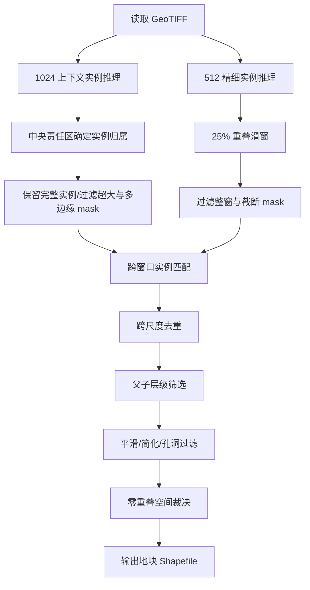
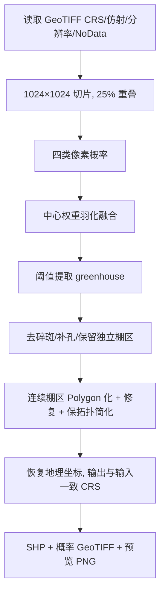

# 工作记录 · SAM3 项目代码结构与识别流程梳理

> 记录日期：2026-09-07
> 服务器：`10.62.11.15`（root）
> 项目目录：`/data3/sam3_project`
> 定位：本项目为下游项目的前序环节，负责对 0.5m 遥感影像进行地物识别，并产出 shp 矢量数据。

---

## 一、项目定位与总体结论

`/data3/sam3_project` 是"影像内容识别 → 产出 shp"的上游识别环节，整体围绕 **SAM3（Segment Anything Model 3）** 及其配套服务展开，主要包含两条相对独立的识别工作流：

| 工作流 | 目标地物 | 核心技术 | 主目录 |
|---|---|---|---|
| 农田地块提取 | 农田（farmland）地块 | SAM3 微调 + 滑窗推理 + 层级后处理 | `sam3_service/`、`sam3_train/` |
| 大棚识别 | 农业大棚（greenhouse） | SegFormer-B3 语义分割 + SAM3 边界细化 | `greenhouse_mapping/` |

两者最终都输出 ESRI Shapefile（`.shp/.shx/.dbf/.prj/.cpg`），并附带概率图 / 预览图 / 报告。

### 关于"2m 超分成 0.5m"

- 本项目代码中**未发现显式的 2m→0.5m 超分（super-resolution）模块**：在业务代码中检索 `超分 / 2m / 2米 / super-resolution / resample / reproject / upscale` 均无业务命中（仅 SAM3 模型内部的 mask 上采样，与"影像超分"无关）。
- 项目输入的影像本身就是 **0.5m 分辨率**。例如前进村影像为 `9855×10171`、RGB 8bit、`0.5 m/像素`、`EPSG:4523`（CGCS2000 3 度带 GK Zone 35）。
- 设计文档中仅提到"若村级影像分辨率不同，则**标准化**到约 0.5m/像素"（普通重采样，非 AI 超分）。
- **结论**："2m 超分成 0.5m"更可能是本项目**更上游的预处理步骤**（或下游项目自身步骤），本项目从 0.5m 影像开始识别。此点建议与需求方进一步确认。

---

## 二、访问与运行环境约定

- 服务器：`ssh root@10.62.11.15`
- Conda 环境：
  - `sam3` —— 现有 SAM3 服务 / 农田推理
  - `sam3_env` —— SAM3 训练
- 激活方式（示例）：

```bash
source /root/anaconda3/etc/profile.d/conda.sh
conda activate sam3
```

- GPU 分配约定：
  - GPU 6 —— SegFormer 训练 / 新项目推理（优先）
  - GPU 0 —— 备用 / SAM3 离线实验
  - GPU 7 —— 保留给现有 SAM3 服务（不可占用）
- 路径注意：
  - 新项目默认目录：`/data3/sam3_project`
  - 旧代码 / 旧文档中大量引用 `/data4/sam3_project`，二者均真实存在；新项目一律以 `/data3/sam3_project` 为准。

---

## 三、目录结构总览

```text
/data3/sam3_project/
├── sam3/                    # SAM3 官方源码、模型权重、示例
│   ├── model/sam3.pt        # 预训练权重（约 3.3GB）
│   ├── sam3/                # SAM3 模型包（model/train/eval/agent/...）
│   ├── scripts/ examples/ results/ assets/
│   ├── interactive_sam3_image_infer.py
│   └── README.md / README_TRAIN.md
├── sam3_service/            # SAM3 服务与 GeoTIFF 农田提取脚本
│   ├── main.py              # FastAPI 后端（上传校验、TIFF 预览、/api/segment）
│   ├── inference.py         # SAM3 模型加载与推理封装
│   ├── config.py / start.sh / requirements.txt
│   ├── geo_infer.py         # 大图补间窗口识别（当前 v3）
│   ├── geotiff_farmland_infer.py            # 农田提取方法一（无重叠滑窗二值）
│   ├── geotiff_farmland_infer_overlap.py    # 方法二（25% 重叠二值融合）
│   ├── geotiff_farmland_parcels.py          # 方法三（512 实例地块）
│   ├── geotiff_farmland_parcels_context.py  # 方法四（多尺度层级实例，当前最完整）
│   ├── geotiff_farmland_parcels_context_resolution_aware.py  # 分辨率感知变体
│   └── FARMLAND_EXTRACTION_METHODS.md / GEOTIFF_FARMLAND_INFER_README.md
├── sam3_train/              # SAM3 农田微调训练
│   ├── Code/sam3-main       # SAM3 源码 + 训练器（hydra）
│   ├── Code/SAM3-retrain    # 交互式再训练小工具
│   ├── Code/sam3_env        # 训练环境
│   ├── sam3_farmland/       # 使用说明 + 样本勾画规范 + 代码/权重副本
│   ├── data/                # 训练数据、影像、COCO 数据集、shp、runs
│   └── smooth/              # 地块边界平滑工具
├── greenhouse_mapping/      # 大棚识别（SegFormer-B3 + SAM3）
│   ├── greenhouse/          # 核心 Python 包（见下）
│   ├── scripts/             # 命令行入口（prepare/train/infer/export/refine...）
│   ├── configs/             # 数据/训练/推理/反馈/精修配置
│   ├── docs/                # 设计规范(specs)与实施计划(plans)
│   ├── models/ outputs/ data/ logs/ tests/
│   └── requirements-*.txt
├── sam3_web/                # Vite 前端（交互式图像分割演示）
├── test_data/               # 测试影像（tif）与结果（result）
├── SAM3_SERVICE_README.md   # SAM3 前后端联调服务说明
└── SAM3_SERVICE_STARTUP.md  # 服务启停说明（systemd + sam3ctl）
```

---

## 四、工作流一：农田地块提取（SAM3）

### 4.1 核心脚本与四种方法

`sam3_service` 提供四种 GeoTIFF 农田提取方法，能力逐级增强：

| 方法 | 脚本 | 特点 | 适用 |
|---|---|---|---|
| 方法一 | `geotiff_farmland_infer.py` | 512×512 无重叠滑窗，实例取并集，二值输出 | 快速出农田总范围 |
| 方法二 | `geotiff_farmland_infer_overlap.py` | 25% 重叠 + 羽化权重融合，接缝少 | 农田覆盖范围统计 |
| 方法三 | `geotiff_farmland_parcels.py` | 保留独立实例，跨窗口匹配，输出独立地块 | 高召回快速试验 |
| 方法四 | `geotiff_farmland_parcels_context.py` | 1024 上下文 + 512 精细双尺度，父子层级筛选 | 一块地一个矢量要素（推荐） |

### 4.2 方法四（多尺度层级实例）流程



关键点：
- 1024 尺度负责上下文，512 尺度负责召回；通过"父子层级"剔除覆盖多个小地块的粗大父 mask。
- 最终按 `score、tile_hits` 排序做零重叠裁决，保证地块间不重叠。
- 输出字段：`parcel_id / class / score / tile_hits / area_m2`。

### 4.3 训练 → 评价 → 识别（`sam3_train/sam3_farmland/项目使用说明.md`）

| 阶段 | 脚本 | 产物 |
|---|---|---|
| 训练 | `sam3/train/train.py`（hydra），微调 SAM3 | `checkpoint_25.pt`（3.4GB） |
| 评价 | `eval_visual.py` / `train_local.py --eval-only` | 评价图 + `metrics_summary.json` |
| 识别 | `sam3_service/geo_infer.py`（当前 v3） | shapefile + 预览 PNG + 参数 JSON |

- 标注流程：ArcMap 勾画 shp → `xml2coco.py` 转 COCO（支持 1008 瓦片 + 128 重叠切块）。
- 识别管线要点（`geo_infer` 系列）：**SLIC 超像素自适应点提示 → 文本+点混合解码 → box 精修 → 双尺度（Context-Core 粗 + Fine-Tile 细）→ 尺度内 mutual-best 去重 → 矢量化 + 层级后处理（重叠裁剪 → 父抑制 → 范围切割 → 相接合并+补洞 → 深色过滤 → 面积过滤）**。
- 说明：因微调后文本提示检出弱、点提示强，故 SLIC 点提示成为主要检测来源。

---

## 五、工作流二：大棚识别（SegFormer-B3 + SAM3）

主设计文档：`greenhouse_mapping/docs/superpowers/specs/2026-09-02-cross-village-greenhouse-mapping-design.md`
边界细化设计：`.../2026-09-04-segformer-sam3-boundary-refinement-design.md`

### 5.1 方案

- 主任务：**监督式多类别语义分割**，模型 **SegFormer-B3**（不用零样本文本提示、不强制实例分割）。
- SAM3 仅作**边界细化**，不替代主模型。
- 第一版输入：单期 RGB TIF，无 DSM/NIR/多时相。

### 5.2 标注体系（像素类别）

| 值 | 类别 | 用途 |
|---|---:|---|
| 0 | `background` | 耕地、林地、水体、道路等背景 |
| 1 | `greenhouse` | 最终输出的棚覆盖范围 |
| 2 | `mulch_film` | 与大棚相似的地膜（困难负样本） |
| 3 | `building_roof` | 房屋/厂房/彩钢屋顶（困难负样本） |
| 255 | `ignore` | 无法判定的区域 |

### 5.3 数据准备

- ArcMap 在原始 GeoTIFF 上标注 Polygon（CRS 与影像一致，EPSG:4523）。
- 若分辨率不同则标准化到约 0.5m/像素。
- 训练切片 1024×1024，保留全部含正样本切片，并重点抽取地膜/屋顶/高反射负样本。
- 采用局部监督：仅已标图斑及 128m 上下文缓冲区内未标像素视为背景，之外全设 `ignore`。

### 5.4 整图推理流程



### 5.5 SAM3 边界细化（可选）

对 SegFormer 候选区域，SAM3 用"正框 + 高置信内部正点 + 外环负点"提示生成多掩膜，按组合分数 + 硬条件（覆盖高置信核心 ≥90%、面积 0.55–1.60 倍、不越入困难背景等）择优；不满足则回退保留 SegFormer 边界。

### 5.6 输出

每村至少输出：`greenhouses.shp/.shx/.dbf/.prj/.cpg`、`greenhouse_probability.tif`、`greenhouse_preview.png`、`inference_report.json`。

SHP 属性：`id / confidence / area_m2 / perim_m / source / model_ver / qa_status`（SAM3 细化版另加 `refined / sam_score`）。

---

## 六、微调机制详解（SAM3 与 SegFormer-B3 到底调了什么）

### 6.1 概念澄清

"sam3 微调做大棚识别和耕地识别"其实包含**两套完全不同的模型与微调策略**：

| 地物 | 主识别模型 | 是否微调 SAM3 | 微调对象 |
|---|---|---|---|
| 耕地/农田（farmland） | SAM3 | 是（产出 `checkpoint_25.pt`） | SAM3 微调 |
| 大棚（greenhouse） | SegFormer-B3 | 否，SAM3 仅边界细化且用原始 `sam3.pt` 不训练 | SegFormer-B3 微调 |

### 6.2 耕地识别：SAM3 微调（冻结双编码器）

配置：`sam3_train/data/runs/finetune_v3/config.yaml`；起点 `sam3.pt`。

**冻结部分（不训练）**（`model_builder.py` 中 `freeze_vision/freeze_language` 实现）：

```python
if freeze_vision:    # 冻结视觉编码器（ViT 图像 backbone）
    for p in model.backbone.vision_backbone.parameters():
        p.requires_grad = False
if freeze_language:  # 冻结语言/文本编码器
    for p in model.backbone.language_backbone.parameters():
        p.requires_grad = False
```

对应配置：`freeze_vision: true`、`freeze_language: true`、`lr_vision_backbone: 0.0`、`lr_language_backbone: 0.0`、`lrd_vision_backbone: 0.0`。

**训练部分**：除上述两个 backbone 外的所有参数，即 **mask 解码器（multiplex_mask_decoder）、提示编码器、视觉-语言融合层（neck/vl_combiner）、语义分割头**，学习率 `lr_transformer = 8e-4 × 0.025 = 2e-5`。

**关键改动**：`enable_segmentation: true` 启用语义分割，损失加入 `loss_semantic_seg(CE=20) + loss_semantic_dice(30) + loss_semantic_presence(1)`，把 SAM3 从"交互式分割（点/框/文本提示）"适配为"农田语义分割"。

其余：数据 `coco_combine_40`（farmland/building/forest 三类）、AdamW（wd=0.1）、梯度裁剪 0.1、AMP bfloat16、batch=1、max_epochs=30、分辨率 1008。

### 6.3 大棚识别：SegFormer-B3 微调（全模型微调）

配置：`greenhouse_mapping/configs/training/segformer_b3_*.yaml`；起点 `models/mit-b3`。

- 分类头改为大棚 4 类（background/greenhouse/mulch_film/building_roof，另 `ignore`）。
- `class_weights: [0.25, 2.5, 1.5, 1.5]` 压制背景、拉高大棚；`boundary_weight: 2.0` 加强边界。
- 全参数可训练（区别于 SAM3 的冻结编码器），`learning_rate: 3e-5`（v2/v3）或 `6e-5`（base），`epochs: 12`（v2/v3）/`30`（base），batch=1、梯度累积 4。
- 输入：0.5m、1024×1024 切片、25% 重叠。
- SAM3 全程不训练：`configs/refinement/sam3_v3.yaml` 的 `checkpoint` 指向原始 `/data3/sam3_project/sam3/model/sam3.pt`，`sam3_adapter.py` 仅做推理封装（`enable_inst_interactivity=True`）。

### 6.4 一句话总结

- **耕地**：从 `sam3.pt` 出发，冻结图像/文本双编码器，只训解码器、提示编码器、融合层与新增语义分割头（lr 2e-5），用三类样本适配成"农田语义分割器"。
- **大棚**：从 MiT-B3 预训练出发，全模型微调语义分割头到 4 类大棚场景；SAM3 不训练，仅用原版 `sam3.pt` 做边界细化。

---

## 七、greenhouse_mapping 核心包结构

```text
greenhouse/
├── data/          # 清单、切片(tiling)、标签栅格化(rasterize)、
│                  # 辐射定标(radiometry)、GeoTIFF 元数据(geotiff_metadata)、反馈(feedback)
├── models/        # SegFormer(segformer)、损失(losses)
├── inference/     # 滑窗(sliding_window)、整图推理(runner)、权重(weights)
├── postprocess/   # mask 清理(mask_cleaning)
├── refinement/    # SAM3 适配(sam3_adapter)、提示(prompts)、精修(runner)、打分(scoring)
├── reporting/     # 报告(report)、预览(preview)、复核比较(feedback_comparison)、校验(verification)
├── gis/           # 矢量(vectorize)、shapefile 输出(shapefile)
├── training/      # 训练器(trainer)、指标(metrics)
└── annotation/    # ArcMap 标注包(arcmap_package)
```

`scripts/` 命令行入口：`prepare_dataset.py`、`build_tiles.py`、`train.py`、`infer.py`、`export_results.py`、`refine_with_sam3.py`、`import_feedback.py`、`compare_feedback.py`、`create_annotation_package.py`、`validate_dataset.py`、`verify_delivery.py`。

---

## 八、SAM3 前后端联调服务（补充）

- 对外：`http://10.62.11.15:8073`（Nginx）
- 内部：前端 `127.0.0.1:4173`，后端 `127.0.0.1:8011`
- 后端：FastAPI，`POST /api/segment`（`image/prompt/display_mode`），返回 mask 可视化结果图。
- 前端：Vite（`sam3_web/`），支持上传、提示词、结果展示与下载。
- 该服务是通用图像分割演示，与"农田/大棚 shp 产出"主流程相对独立。

---

## 九、待确认事项

1. ~~"2m 超分成 0.5m"的具体位置~~ 已澄清：2m 影像在上游先超分成 0.5m，本项目输入即 0.5m 影像（本项目代码中确无超分模块）。
2. **两条工作流的主次关系**：当前下游对接的是"农田地块"还是"大棚"产出，或两者皆有。
3. **输出 SHP 的字段/坐标系约定**：是否与下游项目已有明确对接规范（EPSG:4523、字段名等）。

---

## 十、耕地识别效果测试（宝珠村，2026-09-08）

用本地真实影像 `宝珠村.tif` 端到端测试 SAM3 耕地识别（方法四：多尺度层级实例提取）。

### 10.1 输入影像

- 本地路径：`E:\工作相关\2026年\0624 待测试数据\20260902绵阳(项目任务区)\20260901绵阳对应影像和矢量\宝珠村.tif`
- 大小：179.16 MB；GDAL：5716×5430、4 波段 UInt16、分辨率 0.8 m、`EPSG:4523`（CGCS2000 3 度带 GK Zone 35）
- 上传后：`/data3/sam3_project/test_data/tif/baozhucun.tif`（中文文件名上传异常，落盘后重命名为 ASCII）

### 10.2 运行命令（GPU 6，后台 nohup）

```bash
source /root/anaconda3/etc/profile.d/conda.sh
conda activate sam3
cd /data3/sam3_project/sam3_service
export CUDA_VISIBLE_DEVICES=6
export KMP_DUPLICATE_LIB_OK=TRUE
export SAM3_ROOT=/data3/sam3_project/sam3
nohup python geotiff_farmland_parcels_context.py \
  --input /data3/sam3_project/test_data/tif/baozhucun.tif \
  --output /data3/sam3_project/test_data/result_baozhucun/baozhucun_farmland_parcels.shp \
  --checkpoint /data3/sam3_project/sam3_train/data/runs/finetune_v3/checkpoints/checkpoint_25.pt \
  --prompt farmland > /data3/sam3_project/test_data/result_baozhucun/run.log 2>&1 &
```

### 10.3 结果

- 要素数：**7157 个农田地块（Polygon）**
- 耗时：约 4950 秒（≈82.5 分钟），其中 210 个 fine 窗口 + 132 个 context 窗口，最终后处理/矢量化占大头
- 字段：`parcel_id`(Int64)、`class`(String)、`score`(Real)、`tile_hits`(Int64)、`area_m2`(Real)
- 坐标系：CGCS2000 3 度带 GK Zone 35（EPSG:4523），范围与输入影像一致 `(35461883.6, 3496304.4)~(35466454.8, 3500646.8)`
- 输出文件：`baozhucun_farmland_parcels.shp/.shx/.dbf/.prj/.cpg`（shp 约 35.7 MB）

### 10.4 本地结果路径

`E:\工作相关\2026年\0624 待测试数据\20260902绵阳(项目任务区)\20260901绵阳对应影像和矢量\宝珠村耕地识别结果\`
